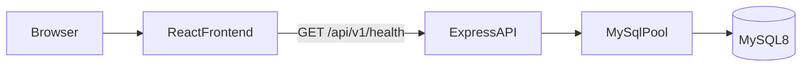
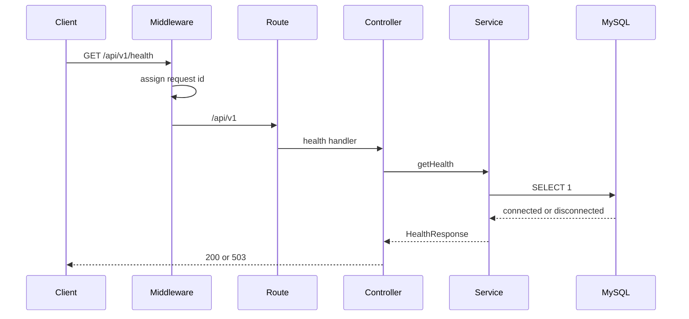
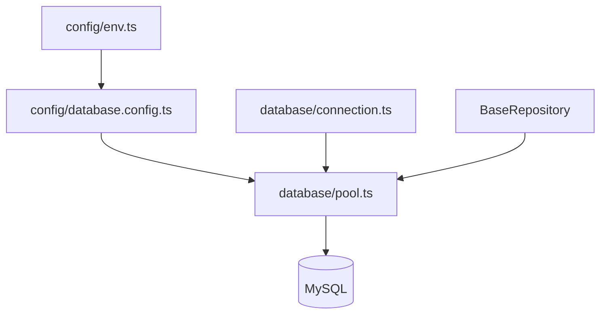
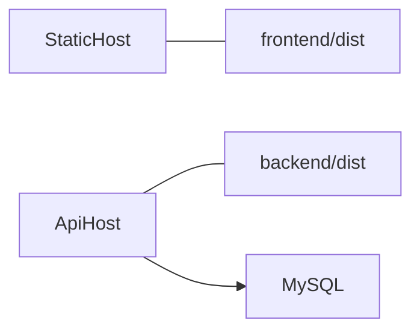

# Architecture

This repository is a foundation for a production web application. The frontend and backend are separate Node projects. They share a contract over HTTP, not a TypeScript package, a workspace, or a build pipeline.

## 1. Overall system architecture



- The frontend is a static Vite application. It can be hosted on any static file server.
- The backend is a Node process. It owns HTTP, configuration, logging, and MySQL.
- MySQL is an external dependency. It is not embedded in either application.
- Neither application imports the other's source files. Health response types are declared twice on purpose.

## 2. Frontend architecture

```text
src/pages/home/HomePage.tsx
  -> src/services/api/health.api.ts
    -> src/services/api/client.ts
      -> src/config/env.ts
        -> VITE_API_BASE_URL
```

Routing:

```text
src/app/router.tsx        BrowserRouter
  -> src/app/routes.tsx   route table
    -> src/layouts/AppLayout.tsx   header, navigation, Outlet
      -> /          HomePage
      -> /about     AboutPage
      -> *          NotFoundPage
```

`HomePage` keeps loading, success, and failure in local React state. `AboutPage` is static. `NotFoundPage` catches any path without a route. The route table is separate from `BrowserRouter` so tests can render it inside `MemoryRouter` at any path. `AppProviders` is the composition root for future context.

`client.ts` is the only module that calls `fetch`. Feature code adds a function next to `health.api.ts` instead of calling the network from a component.

Tailwind is applied through the Vite plugin and `src/styles/index.css`. There is no component library and no global client store.

Folders such as `features/` and `hooks/` are not created until a module needs them.

## 3. Backend architecture

```text
src/main.ts
  -> src/app/server.ts          process, port, shutdown
    -> src/app/app.ts           Express app, no listening
      -> middleware
      -> src/routes/index.ts
        -> modules/health
      -> error middleware
```

`createApp()` returns an Express application. Tests call it without opening a port. `startServer()` is the only function that listens.

Dependency direction:

```text
routes -> controllers -> services -> repositories -> database pool
```

The health module is the exception that proves the rule: its service calls `pingDatabase()` in `src/database/connection.ts`, which is infrastructure, not a business repository. Controllers do not import the pool. Services do not manage connections. SQL for future modules belongs in classes that extend `BaseRepository`.

## 4. HTTP request flow



Unknown paths stop in the not-found middleware. That middleware creates an `AppError`. The error middleware writes one JSON envelope and logs the stack. The stack is not included in the response body. In production, unexpected errors use a generic message.

Every request gets a new `X-Request-Id`. The same value is stored on the request, written to logs, and returned on error JSON.

## 5. MySQL access flow



`getPool()` creates one pool on first use. Later calls return that pool. `closePool()` ends it during shutdown and is safe when the pool was never created.

Pool options include a connection limit, keep-alive, `utf8mb4`, UTC, and `multipleStatements: false`. The migration command uses a separate connection that may run multiple statements. The request path never does.

Credentials are read from the environment. They are not stored in source.

## 6. Repository pattern

`BaseRepository` accepts a `Pool` and exposes `query(sql, params)`. Values are passed to mysql2 as bound parameters, for example `WHERE id = ?`. Callers do not concatenate input into SQL text.

The class has no Express types and no HTTP status codes. A future users module would look like this:

```text
modules/users/users.routes.ts
modules/users/users.controller.ts
modules/users/users.service.ts
modules/users/users.repository.ts   extends BaseRepository
```

The health check does not use this class. `SELECT 1` is an infrastructure probe, not a table query.

## 7. Error handling

Operational failures use `AppError` and a code from `error-codes.ts`.

```json
{
  "success": false,
  "error": {
    "code": "RESOURCE_NOT_FOUND",
    "message": "Resource not found"
  },
  "requestId": "..."
}
```

The health route does not use this envelope. Load balancers and the home page need a stable probe body. A down database is HTTP 503 with `"database": "disconnected"`. An unknown failure inside the probe handler still falls through to the error middleware.

Malformed JSON is HTTP 400 with `VALIDATION_ERROR`.

## 8. Configuration strategy

Backend process environment is read only in `src/config/env.ts`. `loadEnv()` validates HTTP and database settings before the server listens. `getHttpEnv()` is enough for the Express app, so unit tests do not need database variables. `getDatabaseEnv()` runs when the pool or the migrator is created.

Frontend environment is read only in `src/config/env.ts`. The required variable is `VITE_API_BASE_URL`.

`.env` files are gitignored. `.env.example` documents the keys.

## 9. Testing strategy

Backend unit tests live in `tests/health/`. They build the Express app and inject a database check. They assert HTTP status, the health body, and the not-found envelope. `npm test` does not open MySQL.

Backend integration tests live in `tests/database/`. `npm run test:integration` calls `pingDatabase()`, which executes `SELECT 1` through the real pool. A running MySQL 8 database and a configured `.env` are required. They are not part of `npm test`.

Frontend tests mock `health.api` and do not start the API. `HomePage` tests cover the title, loading, a connected payload, and a thrown request. Route tests render the route table at `/`, `/about`, and an unknown path.

## 10. Deployment independence



- Build the frontend with `npm run build` inside `frontend/` and publish `frontend/dist`. Set `VITE_API_BASE_URL` for that build.
- Build the backend with `npm run build` inside `backend/` and run `node dist/main.js`. Provide the same environment variables as `.env.example` on the host.
- Run MySQL separately. Apply SQL with `npm run db:migrate` from a checkout that contains `src/database/migrations`.
- Either application can be released without rebuilding the other, as long as the health JSON contract still matches.
- CORS must list the deployed frontend origin.

Nothing in this repository assumes one machine, one repository pipeline, or a shared `node_modules`.

## 11. Future extension strategy

Add a backend module by copying the health layering: route, controller, service, and a repository when the module reads or writes tables. Register the router in `src/routes/index.ts`. Keep new SQL in the repository and add a numbered file under `src/database/migrations/`.

Add a frontend feature by calling a new function in `src/services/api/` from a page or, later, a feature folder. Introduce a state library only when local state and context stop being enough.

Replace `src/lib/logger.ts` with Pino or another logger behind the same `debug` / `info` / `warn` / `error` methods. Replace `BaseRepository` with an ORM later by keeping services unaware of SQL; only repositories would change.

Authentication, authorization, rate limiting, and security headers beyond Helmet are not implemented. CORS and Helmet are the current baseline. Add those controls at the Express boundary in `app.ts` when the product needs them.

Do not add a root workspace to share types. If a contract needs to be shared, publish it as an explicit versioned package, or keep the small duplicate types until that package is worth its coupling.
